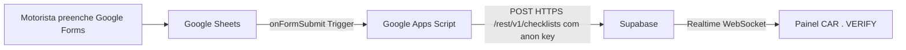

# Diretiva: Ingestão em Tempo Real via Google Forms Webhook (SEC-05)

## Objetivo
Blindar a planilha do Google Sheets removendo o compartilhamento público ("Qualquer pessoa com o link"), migrando a ingestão para um acionador de evento `onFormSubmit` via Google Apps Script que envia checklists instantaneamente para o Supabase.

## Arquitetura

## Passo a Passo de Configuração

### 1. Inserir o Script na Planilha
1. Abra a planilha vinculada ao formulário: `Respostas ao formulário 1`.
2. No menu superior, clique em **Extensões** > **Apps Script**.
3. Apague o código padrão `function myFunction() {}`.
4. Copie e cole todo o conteúdo do arquivo [`execution/google_apps_script.js`](../execution/google_apps_script.js).
5. Clique no ícone de disquete **Salvar** (Ctrl + S).

### 2. Testar o Envio
1. No editor do Apps Script, selecione a função `testarEnvio` no seletor do topo.
2. Clique em **Executar** (Run).
3. Na primeira vez, o Google solicitará permissão para conexões externas (`UrlFetchApp`). Clique em **Revisar permissões**, selecione sua conta e autorize.
4. Veja no log de execução a mensagem `Resposta Supabase: HTTP 201` ou `HTTP 204`.

### 3. Criar o Acionador Automático (Trigger)
1. No menu lateral esquerdo do Apps Script, clique no ícone de **Relógio** (**Acionadores / Triggers**).
2. Clique no botão azul **+ Adicionar acionador** (canto inferior direito).
3. Configure os campos:
   - **Escolha qual função executar:** `enviarChecklistSupabase`
   - **Escolha qual implantação deve ser executada:** `Head`
   - **Selecione a fonte do evento:** `Da planilha`
   - **Selecione o tipo de evento:** `Ao enviar formulário` (On form submit)
   - **Configurações de notificação de falha:** `Notificar imediatamente`
4. Clique em **Salvar**.

### 4. Blindar a Planilha (Tornar 100% Privada)
1. Volte à planilha do Google Sheets.
2. No canto superior direito, clique no botão azul **Compartilhar**.
3. Em **Acesso geral**, altere de:
   - 🔴 *"Qualquer pessoa com o link"*
   - ⬇️
   - 🟢 *"Restrito"* (Apenas as pessoas adicionadas podem abrir este link).
4. Clique em **Concluído**.

---
**Resultado:** A planilha está 100% protegida contra vazamentos externos e o painel CAR . VERIFY recebe novos checklists em tempo real (1 segundo após o envio).
